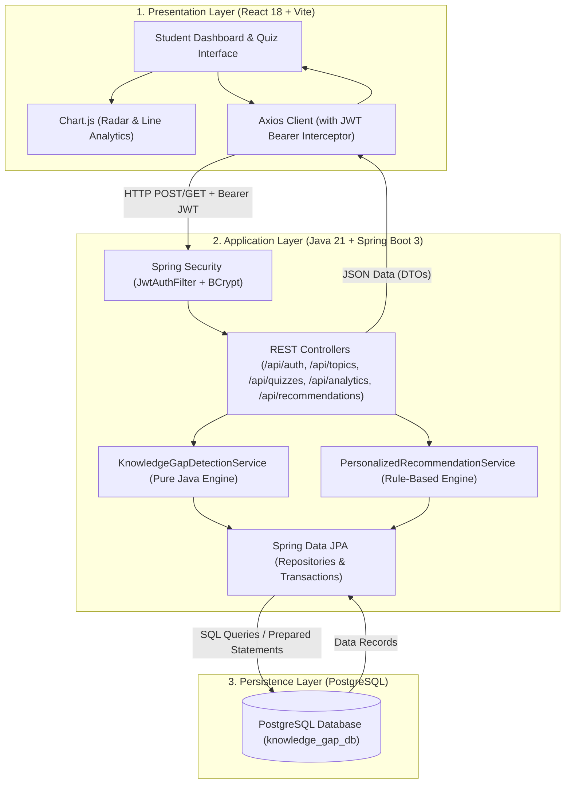

# Master Project Plan: Intelligent Knowledge Gap Detection & Personalized Learning System

## 1. Project Overview & Objectives
The **Intelligent Knowledge Gap Detection and Personalized Learning System** is a full-stack educational platform built for college students. It diagnoses student knowledge deficits at the sub-topic level based on quiz submissions, applies a deterministic knowledge-gap detection algorithm in pure Java, generates personalized remedial learning paths, and visualizes learning trajectories using Chart.js.

### Core Goals
- **Objective Assessment:** Automated, cheat-resistant evaluation of topic-tagged multiple-choice quizzes.
- **Explainable Knowledge Gap Detection:** Deterministic topic-wise mastery analysis categorized into *Critical Gap* (<40%), *Needs Improvement* (40%-69%), *Good Understanding* (70%-84%), and *Strong Understanding* (>=85%).
- **Personalized Recommendations:** Dynamic mapping from identified gaps to targeted learning materials, code examples, and practice assessments.
- **Historical Progress Tracking:** Comparison of sequential attempts to calculate growth metrics ($\Delta$) and detect mastery improvement or regression.
- **Production-Ready & College Defense-Ready:** Built with Java 21, Spring Boot 3, PostgreSQL, React 18, Tailwind CSS, and Chart.js without reliance on costly external black-box AI APIs.

---

## 2. High-Level Architecture & End-to-End Workflow

---

## 3. Technology Stack & Compatibility Matrix

| Tier | Component | Technology & Version | Purpose |
| :--- | :--- | :--- | :--- |
| **Frontend** | Build Tool | Vite 6.x | Fast, modern ESM build system |
| **Frontend** | Framework | React 18 / 19 | Declarative UI component tree |
| **Frontend** | Styling | Tailwind CSS 3.4+ | Utility-first responsive design |
| **Frontend** | Routing | React Router DOM v6 | Client-side routing with protected routes |
| **Frontend** | Visualizations | Chart.js + react-chartjs-2 | Radar charts & Line progress curves |
| **Frontend** | HTTP Client | Axios | REST API communication with interceptors |
| **Backend** | Platform | Java 21 / 26 SE | Core programming language |
| **Backend** | Framework | Spring Boot 3.3.x | Enterprise application framework |
| **Backend** | Security | Spring Security 6 + JJWT | Stateless JWT authentication & BCrypt |
| **Backend** | Persistence | Spring Data JPA / Hibernate | Object-Relational Mapping (ORM) |
| **Backend** | Validation | Jakarta Bean Validation | Server-side request data validation |
| **Database** | RDBMS | PostgreSQL 16 | Relational database with foreign keys & indexes |
| **Testing** | Backend | JUnit 5 + Mockito | Unit tests for algorithms & controllers |
| **Testing** | Frontend | Vite Build & ESLint | Production bundle integrity & syntax checks |

---

## 4. Phase-by-Phase Implementation Checklist

- [x] **Phase 1: Project Inspection & Architecture Finalization**
  - [x] Check system environment (Java 26, Maven 3.9.9, Node 26.7, npm 11.19, PostgreSQL 16).
  - [x] Create project database (`knowledge_gap_db`).
  - [x] Update `PROJECT_PLAN.md` with implementation roadmap.
  - [x] Create `README.md` and initial documentation structure.

- [x] **Phase 2: Project Scaffolding & Configuration**
  - [x] Initialize Spring Boot Maven backend (`backend/pom.xml`, `application.yml`).
  - [x] Initialize React + Vite frontend (`frontend/package.json`, Tailwind configuration).
  - [x] Set up CORS and application properties for development & production.

- [x] **Phase 3: Database Entities & Seed Data**
  - [x] Create JPA Entities: `Student`, `Topic`, `Question`, `QuestionOption`, `QuizAttempt`, `StudentAnswer`, `TopicPerformance`, `LearningResource`, `LearningRecommendation`, `TopicProgress`.
  - [x] Create PostgreSQL schema initialization and seed data (`DataSeeder.java` & `schema.sql`) for Core Java topics, questions, and learning resources.

- [x] **Phase 4: Authentication & Security Module**
  - [x] Implement `JwtTokenProvider`, `JwtAuthenticationFilter`, and `SecurityConfig`.
  - [x] Implement `AuthService` and `AuthController` (`/api/auth/register`, `/api/auth/login`, `/api/auth/me`).
  - [x] Add unit tests for registration, authentication, and JWT validation.

- [x] **Phase 5: Topics, Learning Resources & Quizzes Module**
  - [x] Implement `TopicController`, `TopicService`, and repositories.
  - [x] Implement `QuizController` and `QuizService` for loading quizzes without leaking correct answers.
  - [x] Create question bank categorized by topic and difficulty (Beginner, Intermediate, Advanced).

- [x] **Phase 6: Scoring & Knowledge Gap Detection Algorithm**
  - [x] Implement `KnowledgeGapDetectionService` in pure Java.
  - [x] Calculate topic accuracy, unattempted topic handling, and gap severity tiers.
  - [x] Record `QuizAttempt`, `StudentAnswer`, and `TopicPerformance`.
  - [x] Unit test gap detection with multiple answer variations.

- [x] **Phase 7: Personalized Recommendation Engine**
  - [x] Implement `PersonalizedRecommendationService`.
  - [x] Map detected weak topics to tailored explanations, code examples, and practice activities.
  - [x] Include human-readable justification for why each recommendation was generated.

- [x] **Phase 8: Student Dashboard, Analytics & Progress Tracking**
  - [x] Implement `/api/analytics/dashboard`, `/api/analytics/topics`, and `/api/analytics/progress`.
  - [x] Calculate sequential progress deltas ($\Delta = \text{Current} - \text{Previous}$) to show improvement.
  - [x] Build API endpoints for learning material completion tracking.

- [x] **Phase 9: Frontend Development & API Integration**
  - [x] Build React layout: Navbar, Protected Routes, Footer.
  - [x] Build Pages: Login, Register, Student Dashboard, Topic List, Topic Detail/Study Page, Quiz Taker, Quiz Result, Recommendations Hub, Assessment History, Profile.
  - [x] Integrate Chart.js: Topic Mastery Radar Chart and Historical Progress Line Chart.

- [x] **Phase 10: Testing, Debugging & Workflow Validation**
  - [x] Run backend tests (JUnit 5 + Mockito) and verify compilation.
  - [x] Run frontend build (`npm run build`) and fix any bundle or linting issues.
  - [x] End-to-end test the complete student journey (Register -> Login -> Take Quiz -> Evaluate -> Inspect Dashboard & Gaps -> Study -> Retake -> Verify Delta).

- [x] **Phase 11: Production Preparation & Deployment Configuration**
  - [x] Configure environment variables (`VITE_API_URL`, database connection pooling, production profile).
  - [x] Add Dockerfile / Render build configs and Vercel static build specs.
  - [x] Create health check endpoint `/api/health`.

- [x] **Phase 12: Documentation & Final Verification**
  - [x] Complete `docs/ARCHITECTURE.md`, `docs/DATABASE_SCHEMA.md`, `docs/API_DOCUMENTATION.md`, `docs/SETUP.md`, `docs/TESTING.md`, `docs/DEPLOYMENT.md`.
  - [x] Final verification of all acceptance criteria.
