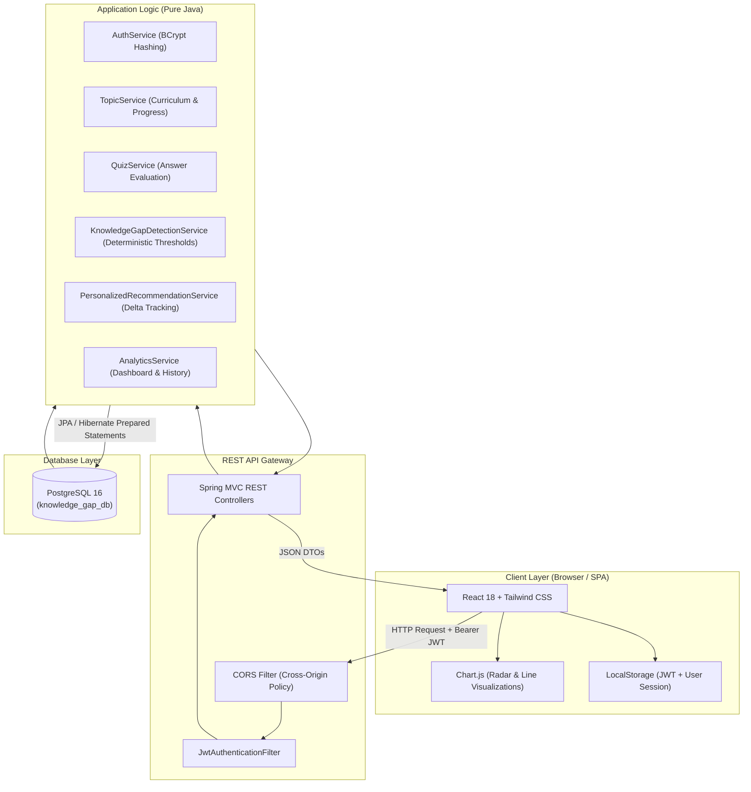

# System Architecture Document

## 1. Executive Summary
The **Intelligent Knowledge Gap Detection and Personalized Learning System** (`EduGap`) is an educational platform designed to evaluate college students on core software concepts, identify sub-topic level misconceptions using a deterministic algorithm in pure Java, generate personalized remedial recommendations, and track learning progress over time.

---

## 2. Architectural Paradigm

The system follows a classic **3-Tier Decoupled Client-Server Architecture**:
1. **Client / Presentation Layer:** React 18 SPA built with Vite, Tailwind CSS, and Chart.js.
2. **Server / Application Logic Layer:** Java 21 REST API built with Spring Boot 3.3.x, Spring Security, and JJWT.
3. **Persistence / Data Layer:** PostgreSQL 16 relational database with Spring Data JPA / Hibernate ORM.

---

## 3. Communication Protocol

### 3.1 Client-to-Server
- **Protocol:** HTTP/1.1 over TLS (HTTPS in production, HTTP locally).
- **Format:** Strict JSON (`application/json`) payloads.
- **Security:** Stateless Bearer Token Authorization (`Authorization: Bearer <jwt-token>`).
- **Network Proxy:** Vite development proxy redirects `/api/*` to `http://localhost:8080/api/*`, eliminating local CORS friction.

### 3.2 Server-to-Database
- **Connection Pool:** HikariCP connection pool with maximum 10 active connections.
- **ORM:** Hibernate 6 / Spring Data JPA with parameterized prepared statements preventing SQL Injection attacks.
- **Schema Strategy:** Hibernate automatic schema migration (`ddl-auto: update`) coupled with `DataSeeder.java` for idempotent initialization.

---

## 4. Intelligent Knowledge Gap Detection Engine

### 4.1 Pure Java Implementation
The gap analysis runs without expensive black-box third-party AI APIs, guaranteeing 100% explainability during college project evaluations:

1. **Topic-Level Accuracy Computation:**
   $$\text{Accuracy}(T) = \left( \frac{\text{Correct Answers in } T}{\text{Attempted Questions in } T} \right) \times 100\%$$

2. **Categorization Rules:**
   - **Unassessed:** $\text{Attempted} = 0 \implies \text{NOT\_ASSESSED}$ (Prevents false positives).
   - **High-Priority Knowledge Gap:** $\text{Accuracy} < 40\% \implies \text{HIGH\_PRIORITY\_GAP}$
   - **Needs Improvement:** $40\% \le \text{Accuracy} < 70\% \implies \text{NEEDS\_IMPROVEMENT}$
   - **Good Understanding:** $70\% \le \text{Accuracy} < 85\% \implies \text{GOOD\_UNDERSTANDING}$
   - **Strong Understanding:** $\text{Accuracy} \ge 85\% \implies \text{STRONG\_UNDERSTANDING}$

3. **Delta Progress Tracking ($\Delta$):**
   $$\Delta(T) = \text{Accuracy}_{\text{recent}}(T) - \text{Accuracy}_{\text{previous}}(T)$$
   - $\Delta > 0$: Positive Growth.
   - $\Delta < 0$: Knowledge Decay / Regression (triggers targeted alerts).
