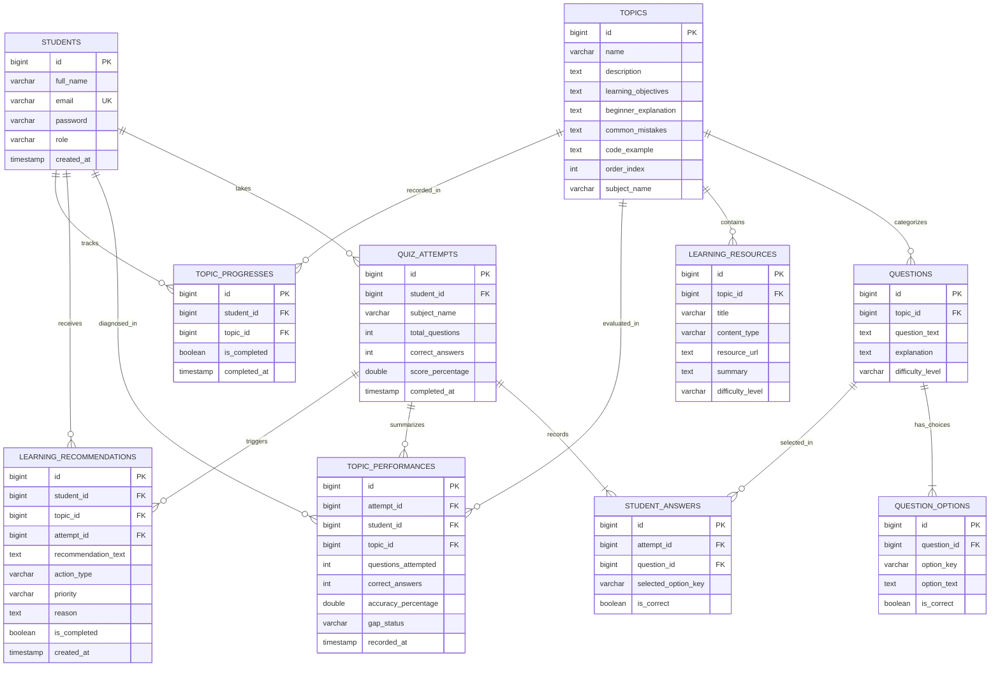

# PostgreSQL Database Schema & Relationships

## 1. Entity-Relationship (ER) Diagram

---

## 2. Table Specifications & Constraints

### 2.1 `students`
Stores student authentication and profile credentials.
- `id` (BIGSERIAL, Primary Key)
- `email` (VARCHAR 150, Unique Index, Non-null)
- `password` (VARCHAR 255, BCrypt hashed, Non-null)
- `full_name` (VARCHAR 100, Non-null)
- `role` (VARCHAR 20, Default `ROLE_STUDENT`)
- `created_at` (TIMESTAMP, Non-null)

### 2.2 `topics`
Core Java curriculum modules.
- `id` (BIGSERIAL, Primary Key)
- `name` (VARCHAR 100, Non-null)
- `description` (TEXT)
- `learning_objectives` (TEXT)
- `beginner_explanation` (TEXT)
- `common_mistakes` (TEXT)
- `code_example` (TEXT)
- `order_index` (INT)
- `subject_name` (VARCHAR 50, Default `Core Java`)

### 2.3 `questions` & `question_options`
Question bank categorized by topic and difficulty level (`BEGINNER`, `INTERMEDIATE`, `ADVANCED`).
Options store the choice key (`A`, `B`, `C`, `D`) and `is_correct` boolean. The boolean is strictly kept on the server and never exposed in the quiz taking API.

### 2.4 `quiz_attempts` & `student_answers`
Maintains permanent audit history of every student submission. Each question answered is recorded alongside whether the student's selected key matched the verified key.

### 2.5 `topic_performances`
Maintains topic-level breakdown metrics for each attempt. Includes accuracy percentage and assigned gap status (`HIGH_PRIORITY_GAP`, `NEEDS_IMPROVEMENT`, `GOOD_UNDERSTANDING`, `STRONG_UNDERSTANDING`, `NOT_ASSESSED`).

### 2.6 `learning_recommendations`
Stores personalized remedial suggestions linked to specific weak topics. Contains human-readable `reason` explainability notes.

### 2.7 `topic_progresses`
Tracks student self-study completion status per topic with a unique constraint on `(student_id, topic_id)`.
